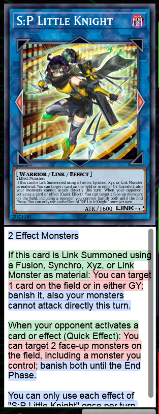

# Dueling-Book---Master-Duel-Formatting-PSCT-Color-Highlighter
a Tempermonkey script that adds Master Duel like formatting and a PSCT color highlighter to Dueling Book.

How To Install:
1. Install Tampermonkey
2. Download the script or copy its content.
3. In the Tempermonkey Dashboard click on Utilities and import the script or make a new one and replace the text with the one you copied.

